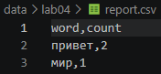
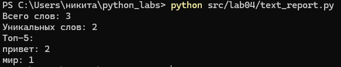
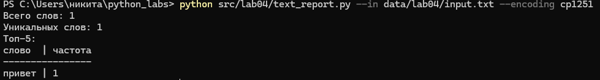
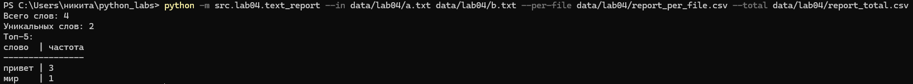
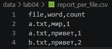
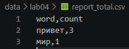

# Задание A - io_txt_csv.py

Реализован модуль для чтения текстовых файлов и записи результатов в CSV. Для работы с путями используется Path, а для формирования CSV — стандартный модуль csv.

Реализованы следующие функции:  

## 1. Функция **read_text**

Функция читает файл целиком и возвращает его содержимое в виде одной строки. По умолчанию используется кодировка UTF-8, но при необходимости можно передать другую кодировку, например encoding="cp1251".

Если файл не найден, возникает FileNotFoundError. При несовпадении кодировки возникает UnicodeDecodeError.

## 2. Функция **write_csv**

Функция записывает строки в CSV-файл. Перед записью проверяется, что все строки имеют одинаковую длину. Если длины отличаются, вызывается ValueError.

Если передан параметр header, он записывается первой строкой файла.

## 3. Функция **ensure_parent_dir**

Функция проверяет наличие родительской папки и создает ее вместе со всеми отсутствующими вложенными папками.


## Пример запуска



Рис. 1. Результат записи данных в CSV-файл

# Задание B - скрипт статистики text_report.py

Скрипт читает текстовые файлы, использует функции normalize, tokenize, count_freq и top_n из лабораторной работы №3, а затем сохраняет частоты слов в CSV-файлы.

## Пример запуска для одного файла

```bash
python src/lab04/text_report.py
```
В этом режиме читается data/lab04/input.txt, а результат записывается в data/lab04/report.csv.



Рис. 2. Результат запуска скрипта для 1 входного файла.

## Кодировка cp1251
```bash
python src/lab04/text_report.py --in data/lab04/input.txt --encoding cp1251
```


 

## Пример запуска для нескольких файлов

```bash
python src/lab04/text_report.py --in data/lab04/a.txt data/lab04/b.txt
```

В этом режиме отдельно создаются report_per_file.csv и report_total.csv.



Рис. 3. Результат запуска скрипта для нескольких входных файлов.

## Отчёт по файлам

### report_per_file.csv



### report_total.csv

