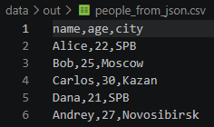
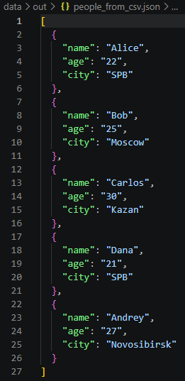
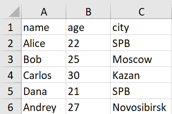

# Лабораторная работа №5 — JSON и конвертации (JSON↔CSV, CSV→XLSX)

## Задание A — `src/lab05/json_csv.py`

Модуль реализует двустороннюю конвертацию между форматами JSON и CSV с использованием стандартных библиотек `json`, `csv`, `pathlib` и вспомогательной функции `ensure_parent_dir` из `src.lib.io_txt_csv` (ЛР4) для автоматического создания родительских директорий.

### Код модуля `src/lab05/json_csv.py`

```python
import json
import csv
from pathlib import Path
from src.lib.io_txt_csv import ensure_parent_dir

def json_to_csv(json_path: str, csv_path: str) -> None:
    '''Записывает значения

    Args:
        json_path: Путь к json файлу из которого читаем
        csv_path: Путь к csv файлу куда пишем

    Returns: 
        None

    Raises:
        FileNotFoundError: 
            Указанный JSON файл не найден
        ValueError:
            Указанный файл не формата JSON
            Пустой JSON или неподдерживаемая структура
            Файл JSON пустой или имеет неправильный формат
            Все элементы списка JSON должны быть словарями
    '''
    json_path = Path(json_path)
    csv_path = Path(csv_path)

    if not json_path.exists():
        raise FileNotFoundError("Указанный JSON файл не найден")

    if json_path.suffix.lower() != '.json':
        raise ValueError("Указанный файл не формата JSON")

    try:
        with json_path.open('r', encoding='utf-8') as p:
            data = json.load(p)
    except json.JSONDecodeError:
        raise ValueError("Пустой JSON или неподдерживаемая структура")

    if not isinstance(data, list) or len(data) == 0:
        raise ValueError('Файл JSON пустой или имеет неправильный формат')
    
    if not all(isinstance(item, dict) for item in data):
        raise ValueError("Все элементы списка JSON должны быть словарями")

    ensure_parent_dir(csv_path)
    fieldnames = {}
    for element in data:
        for key in element.keys():
            fieldnames[key] = None

    with csv_path.open('w', newline="", encoding='utf-8') as f:
        w = csv.DictWriter(f, fieldnames=list(fieldnames.keys()))
        w.writeheader()
        w.writerows(data)


def csv_to_json(csv_path: str, json_path: str) -> None:
    '''Записывает значения

    Args:
        csv_path: Путь к csv файлу из которого читаем
        json_path: Путь к json файлу куда пишем

    Returns: 
        None

    Raises:
        FileNotFoundError: 
            Указанный CSV файл не найден
        ValueError:
            Указанный файл не формата CSV
            Файл CSV пустой
            Файл CSV не содержит данных
    '''
    json_path = Path(json_path)
    csv_path = Path(csv_path)

    if not csv_path.exists():
        raise FileNotFoundError("Указанный CSV файл не найден")

    if csv_path.suffix.lower() != '.csv':
        raise ValueError("Указанный файл не формата CSV")

    with csv_path.open("r", newline="", encoding="utf-8") as f:
        reader = csv.DictReader(f)
        if reader.fieldnames is None:
            raise ValueError("Файл CSV пустой")

        data = list(reader)

    if not data:
        raise ValueError("Файл CSV не содержит данных")

    ensure_parent_dir(json_path)
    with json_path.open('w', encoding='utf-8') as p:
        json.dump(data, p, ensure_ascii=False, indent=2)

if __name__ == "__main__":
    json_to_csv("data/samples/people.json", "data/out/people_from_json.csv")
    csv_to_json("data/samples/people.csv", "data/out/people_from_csv.json")
```

### Описание логики и допущений (Задание A)
- **Кодировка**: все файлы читаются и записываются строго в `UTF-8`.
- **Порядок колонок при `JSON → CSV`**: заголовки собираются через словарь `fieldnames = {}` по всем объектам списка. В Python `dict` сохраняет порядок добавления ключей, поэтому колонки идут в порядке ключей первого объекта (а если в следующих словарях появляются новые ключи — они добавляются в конец в порядке появления). Отсутствующие поля автоматически заполняются пустыми строками в `csv.DictWriter`.
- **Формат при `CSV → JSON`**: первая строка CSV считается обязательным заголовком, значения сохраняются как строки с форматированием `ensure_ascii=False, indent=2`.
- **Обработка ошибок**:
  - отсутствие входного файла — `FileNotFoundError`;
  - неверное расширение файла (не `.json` или не `.csv`), пустой файл, некорректный синтаксис JSON, список без словарей или CSV без данных — `ValueError`.

---

## Задание B — `src/lab05/csv_xlsx.py`

Модуль конвертирует CSV-файл в таблицу Excel (`.xlsx`) с помощью библиотеки `openpyxl`.

### Код модуля `src/lab05/csv_xlsx.py`

```python
from openpyxl import Workbook
import csv
from pathlib import Path
from src.lib.io_txt_csv import ensure_parent_dir

def csv_to_xlsx(csv_path: str, xlsx_path: str) -> None:
    '''Конвертирует CSV файл в формат XLSX.

        Args:
            csv_path: Путь к исходному CSV файлу
            xlsx_path: Путь для сохранения XLSX файла

        Returns:
            None

        Raises:
            FileNotFoundError:
                Указанный CSV файл не найден
            ValueError:
                Указанный файл не формата CSV
                Файл CSV пустой
        '''
    csv_path = Path(csv_path)
    xlsx_path = Path(xlsx_path)

    if not csv_path.exists():
        raise FileNotFoundError("Указанный CSV файл не найден")

    if csv_path.suffix.lower() != '.csv':
        raise ValueError("Указанный файл не формата CSV")

    with csv_path.open('r', newline='', encoding='utf-8') as f:
        reader = list(csv.reader(f))

    if not reader:
        raise ValueError("Файл CSV пустой")

    wb = Workbook()
    ws = wb.active

    assert ws is not None
    ws.title = "Sheet1"
    for row in reader:
        ws.append(row)

    for col in ws.columns:
        max_len = 0
        letter = col[0].column_letter

        for cell in col:
            if cell.value and len(str(cell.value)) > max_len:
                max_len = len(str(cell.value))

        ws.column_dimensions[letter].width = max(max_len, 8)

    ensure_parent_dir(xlsx_path)
    wb.save(xlsx_path)

if __name__ == "__main__":
    csv_to_xlsx("data/samples/people.csv", "data/out/people.xlsx")
```

### Описание логики и допущений (Задание B)
- **Структура книги**: создается книга `Workbook()`, активный лист переименовывается в `"Sheet1"`, и все строки из `csv.reader` построчно добавляются через `ws.append(row)`.
- **Автоширина колонок**: для каждого столбца вычисляется максимальная длина строкового значения ячейки `max_len`, после чего ширина колонки выставляется как `max(max_len, 8)` (не менее 8 символов).
- **Зависимости**: используется пакет `openpyxl` (указан в `requirements.txt`).

---

## Команды запуска и сценарии демонстрации

Установка зависимостей:
```bash
pip install -r requirements.txt
```

### 1. Сценарий `JSON ↔ CSV` (`people.json` → `people_from_json.csv`, `people.csv` → `people_from_csv.json`)
Запуск модуля из корня репозитория:
```bash
python -m src.lab05.json_csv
```
- В `data/out/people_from_json.csv` формируется таблица с заголовком из ключей JSON и тем же количеством записей.
- В `data/out/people_from_csv.json` формируется список словарей с отступами `indent=2`, совпадающий по ключам и числу объектов с исходным CSV.


### Результат JSON to CSV


### Результат CSV to JSON


### 2. Сценарий `CSV → XLSX` (`people.csv` → `people.xlsx`)
Запуск модуля из корня репозитория:
```bash
python -m src.lab05.csv_xlsx
```
- В `data/out/people.xlsx` создается таблица с листом `Sheet1` и автоматической шириной колонок (не менее 8 символов).


### Результат CSV to XLSX
