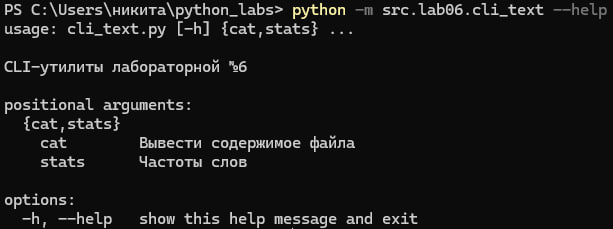
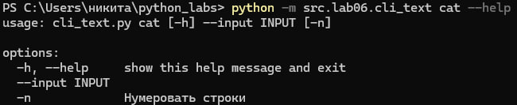
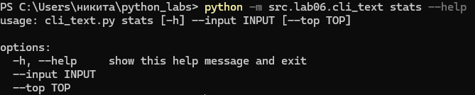
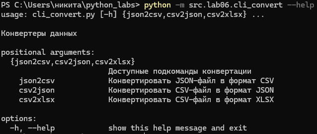
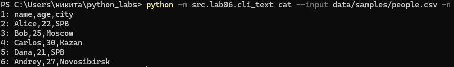
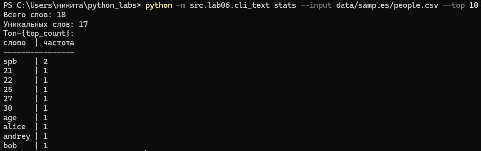
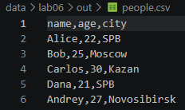
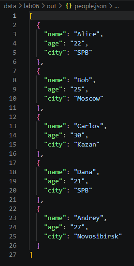
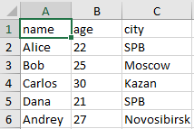

# Лабораторная работа 6. CLI-утилиты с argparse

## Описание
Консольные утилиты для анализа текста и конвертации данных между форматами JSON, CSV и XLSX на базе стандартного модуля `argparse`.

Файлы:
- `src/lab06/cli_text.py` - утилита для работы с текстом (`cat`, `stats`).
- `src/lab06/cli_convert.py` - утилита для конвертации файлов (`json2csv`, `csv2json`, `csv2xlsx`).

## Описание подкоманд и параметров

### Модуль cli_text.py
- `cat` - построчный вывод содержимого файла.
  - `--input` - путь к файлу (обязательный).
  - `-n` - включить нумерацию строк (необязательный флаг).
- `stats` - подсчет частоты слов в тексте.
  - `--input` - путь к текстовому файлу (обязательный).
  - `--top` - количество частых слов для вывода (по умолчанию 5).

### Модуль cli_convert.py
- `json2csv` - перевод из JSON в CSV (`--in`, `--out`).
- `csv2json` - перевод из CSV в JSON (`--in`, `--out`).
- `csv2xlsx` - перевод из CSV в XLSX (`--in`, `--out`).

## Демонстрация работы

### 1. Вывод справки (--help)
```bash
python -m src.lab06.cli_text --help
python -m src.lab06.cli_text cat --help
python -m src.lab06.cli_text stats --help
python -m src.lab06.cli_convert --help
```









### 2. Команда cat
Вывод строк файла с нумерацией:
```bash
python -m src.lab06.cli_text cat --input data/samples/people.csv -n
```



### 3. Команда stats
Вывод топ-10 самых частых слов:
```bash
python -m src.lab06.cli_text stats --input data/samples/people.txt --top 10
```




### 4. Конвертация данных
```bash
python -m src.lab06.cli_convert json2csv --in data/samples/people.json --out data/lab06/out/people.csv
python -m src.lab06.cli_convert csv2json --in data/samples/people.csv --out data/lab06/out/people.json
python -m src.lab06.cli_convert csv2xlsx --in data/samples/people.csv --out data/lab06/out/people.xlsx
```






