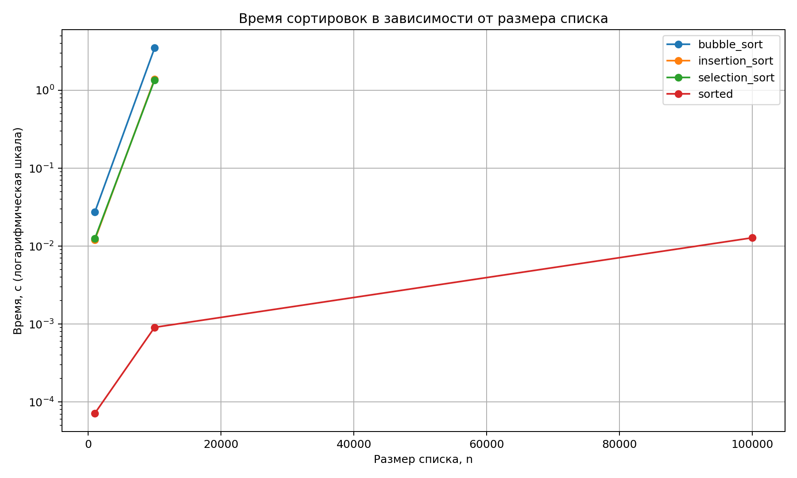
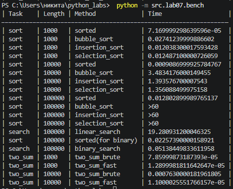

# Лабораторная работа 7. Поиск, сортировка и измерение времени

## Описание
Реализованы линейный и бинарный поиск, два решения Two Sum, сортировки пузырьком, вставками и выбором. Сортировки возвращают новый список и сохраняют исходный. В пузырьковой сортировке добавлен ранний выход при отсутствии обменов. Бинарному поиску нужен список, отсортированный по возрастанию.

Файлы:
- `search.py` — поиск и Two Sum.
- `sorting.py` — три сортировки без готовых алгоритмов сортировки.
- `check.py` — простые проверки на случайных данных.
- `bench.py` — замеры через `timeit`, вывод таблицы и запись CSV через `write_csv` из ЛР4.
- `plot.py` — построение графика сортировок по сохранённому CSV.
- [bench.csv](../../data/lab07/bench.csv) — результаты замеров.

## Запуск
Из корня репозитория:
```bash
python -m src.lab07.check
python -m src.lab07.bench
```
Дополнительные пакеты не требуются. Бенчмарк выводит таблицу в консоль и перезаписывает `data/lab07/bench.csv`. Продолжительность зависит от компьютера.

## Проверка корректности
```text
python -m src.lab07.check
OK: все проверки пройдены
```
Для каждой сортировки, поиска и Two Sum выполняется по 100 случайных прогонов. Сортировки сравниваются с `sorted`, линейный поиск — с `list.index`, решение Two Sum со словарём — с перебором. Проверяются сохранность исходного списка при сортировке и корректность найденных индексов. Бинарный поиск и Two Sum могут вернуть любой допустимый ответ. Генераторы случайных чисел локальные, с фиксированным seed для повторяемости проверок.

## Бенчмарк
Используется `random.seed(42)`; для каждого размера все сравниваемые алгоритмы получают одни и те же данные. Отдельные вызовы измеряются через `timeit` с `number=1`, без повторных серий и усреднения. Время зависит от нагрузки компьютера. Девять знаков после точки — формат вывода, а не гарантия точности. Таблица ниже соответствует сохранённому `data/lab07/bench.csv`.

Поиск измеряется на 10 000 одинаковых для обоих алгоритмов запросов к списку из 100 000 чисел. Запросы выбираются через `random.choice(data)`, поэтому каждый элемент гарантированно присутствует в списке. В таблицу записывается сумма времени отдельных запросов. Подготовка отсортированного списка измеряется отдельно как `sorted(for binary)`; рабочий список затем создаётся ещё одним вызовом `sorted` вне замера запросов.

Для сортировок и Two Sum используются случайные целые числа от −1 000 000 до 1 000 000. В Two Sum цель равна `data[1] + data[42]`, поэтому решение гарантировано. Алгоритмы возвращают первую найденную пару, которая может отличаться от заданной; эти замеры не показывают стоимость полного перебора всех пар.

При размере 100 000 измеряется только `sorted`. Три учебные сортировки пропускаются: код записывает для них строку `>60` без запуска. Эта пометка не является измеренным временем или подтверждённым превышением лимита.

| Задача | n | Реализация | Время, с |
|---|---:|---|---:|
| sort | 1000 | sorted | 0.000071700 |
| sort | 1000 | bubble_sort | 0.027412400 |
| sort | 1000 | insertion_sort | 0.012038300 |
| sort | 1000 | selection_sort | 0.012487100 |
| sort | 10000 | sorted | 0.000908700 |
| sort | 10000 | bubble_sort | 3.483417600 |
| sort | 10000 | insertion_sort | 1.393576700 |
| sort | 10000 | selection_sort | 1.356088500 |
| sort | 100000 | sorted | 0.012802900 |
| sort | 100000 | bubble_sort | `>60` (пропущено) |
| sort | 100000 | insertion_sort | `>60` (пропущено) |
| sort | 100000 | selection_sort | `>60` (пропущено) |
| search | 100000 | linear_search | 19.280931200 |
| sort | 100000 | sorted(for binary) | 0.022573900 |
| search | 100000 | binary_search | 0.051384498 |
| two_sum | 1000 | two_sum_brute | 0.000078600 |
| two_sum | 1000 | two_sum_fast | 0.000012900 |
| two_sum | 10000 | two_sum_brute | 0.000763000 |
| two_sum | 10000 | two_sum_fast | 0.000011000 |

## График сортировок



График построен по `bench.csv`: по оси X — размер списка n, по оси Y — время в секундах в логарифмической шкале. Показаны `bubble_sort`, `insertion_sort`, `selection_sort` и `sorted`. Значения `>60` для трёх учебных сортировок при n = 100 000 пропущены, поскольку это не измерения. Строка `sorted(for binary)` относится к подготовке данных для поиска и в серии сортировок не включена.

Для повторного построения из корня репозитория (требуется `matplotlib` из `requirements.txt`):

```bash
python -m src.lab07.plot
```

## Выводы
При увеличении размера случайного списка с 1 000 до 10 000 пузырьковая сортировка замедлилась примерно в 127 раз, а `sorted` — в 12,7 раза. Для трёх учебных сортировок средняя и худшая временная сложность — O(n²), для `sorted` худшая — O(n log n). Замеры показывают более быстрый рост затрат квадратичных алгоритмов, но один запуск не позволяет точно оценить зависимость времени от размера данных. Учебные сортировки на 100 000 элементов в текущем коде не измеряются.

Бинарный поиск отбрасывает половину диапазона только благодаря порядку элементов: для неотсортированных данных он может пропустить ответ. Линейные запросы заняли около 19,281 с, сортировка — 0,022574 с, бинарные запросы — 0,051384 с; вместе подготовка и бинарные запросы заняли около 0,074 с. Подготовка окупается при повторных поисках по одному списку, когда T(сортировки) + q·T(бинарного) меньше q·T(линейного); для одиночного запроса линейный поиск часто выгоднее. Все проверки `check.py` пройдены без расхождений.

В Two Sum перебор имеет худшую сложность O(n²), а решение со словарём — ожидаемую O(n) и требует O(n) дополнительной памяти. В текущем бенчмарке ответ может находиться рано, поэтому по этим двум размерам нельзя делать вывод о росте времени полного перебора.

## Демонстрация работы
Скриншот результатов проверки и бенчмарка:


